# Laporan Tugas Minggu 12: CRUD dalam CodeIgniter 4 — Manajemen Kategori, Produk, Galeri Foto, Karyawan & Katalog Dwibahasa (ShopEase)

**Mata Kuliah:** Pemrograman Berbasis Kerangka Kerja (PBKK)  
**Nama:** Farrel Prastita Ramadhan  
**NRP:** 5025241219  
**Program Studi:** Teknik Informatika, Institut Teknologi Sepuluh Nopember (ITS)  
**Materi:** CRUD dalam CodeIgniter 4 · Manajemen Kategori, Produk, Upload Multi-Foto, Direktori Karyawan & Katalog Belanja ShopEase  
**Referensi Materi:**  
- [CRUD dalam CI — Fajar Baskoro](https://fajarbaskoro.blogspot.com/2021/05/crud-dalam-ci.html)  
- Hands-On Lab ShopEase (Praktikum 4: CRUD Kategori, Praktikum 5: CRUD Produk & Upload Gambar, Praktikum 6: AuthFilter RBAC, Praktikum 7: Frontend Katalog)  
**Teknologi:** CodeIgniter 4.7.6 · PHP 8.2+ (ekstensi `intl`, `mbstring`, `gd`, `sqlite3`/`mysqli`) · SQLite3 / MySQL (`db_shopease`) · Bootstrap 5 · Custom Light/Dark Theme CSS

---

## 1. Deskripsi Singkat

**ShopEase (Minggu 12)** merupakan aplikasi katalog belanja dwibahasa (**Bahasa Indonesia & English**) yang terintegrasi dengan ruang kerja operasional untuk **Administrator** dan **Operator** dalam satu aplikasi CodeIgniter 4:

- **Katalog Belanja Publik (`/`, `/catalog`, `/product/{slug}`)**: Pencarian produk, filter kategori, pengurutan (terbaru, harga terendah, harga tertinggi), paginasi, halaman detail produk dengan galeri multi-foto interaktif, label status stok (tersedia, stok menipis 1–5 unit, stok habis 0), serta produk terkait. Produk berstatus *Tidak Tersedia (`inactive`)* disembunyikan otomatis dari katalog pelanggan.
- **CRUD Kategori (`/{admin|operator}/categories`)**: Tambah (nama utama, nama Bahasa Indonesia opsional, deskripsi, slug otomatis), tampil dalam kartu lengkap dengan jumlah produk terhubung, edit, dan hapus dengan **perlindungan integritas relasi** (kategori yang masih memiliki produk tidak dapat dihapus sebelum produknya dipindahkan/dihapus).
- **CRUD Produk & Galeri Multi-Foto (`/{admin|operator}/products`)**: Ringkasan inventaris (total, tersedia, stok menipis 1–5, stok habis 0), pencarian berpaginasi, filter kategori/status/stok, formulir tambah & edit produk dengan validasi server-side, unggah hingga **6 foto per produk** (JPEG, PNG, WebP · maks 2 MiB · maks 4096px/8MP · nama file acak), pratinjau klien sebelum unggah, penetapan **Gambar Utama**, dan hapus foto.
- **CRUD Direktori Karyawan (`/admin/employees` — khusus Administrator)**: Tambah, lihat detail, ubah, dan hapus data karyawan (kode unik, email kantor unik, jabatan, departemen, tanggal bergabung, status kepegawaian, telepon opsional), lengkap dengan pencarian nama/kode/departemen serta filter departemen & status.
- **Akun, RBAC, Preferensi Bahasa & Tema**: Halaman masuk tunggal (`/login`), registrasi pelanggan (`/register`), profil (`/profile`), perintah CLI `php spark accounts:role <email> <role>`, toggle bahasa **ID / EN**, dan toggle tema **Terang / Gelap** responsif di desktop maupun ponsel.

---

## 2. Arsitektur MVC & Relasi Database

```text
Admin / Operator ──▶ Routes (CSRF + AuthFilter RBAC) ──▶ Controllers ──▶ Models ──▶ Database (SQLite / MySQL)
                                                               │
                                         ┌─────────────────────┼─────────────────────┐
                                         ▼                     ▼                     ▼
                                 CategoryController     ProductController    EmployeeController
                                   (categories)      (products + product_images)  (employees)
```

### Skema Relasi Tabel ([`database/db_shopease_crud.sql`](shopease/database/db_shopease_crud.sql))

| Tabel | Primary Key | Foreign Key & Relasi | Fungsi |
| :--- | :---: | :--- | :--- |
| `users` | `id` | — | Akun login Administrator, Operator, dan Customer (password hash bcrypt). |
| `categories` | `id` | `1 : N` ke `products` | Kelompok kategori produk dwibahasa (`name`, `name_id`, `slug`). |
| `products` | `id` | `category_id → categories.id` (`ON DELETE RESTRICT`) | Data produk, harga `DECIMAL(12,2)`, stok, dan status ketersediaan (`active`/`inactive`). |
| `product_images` | `id` | `product_id → products.id` (`ON DELETE CASCADE`) | Galeri multi-foto produk hingga 6 gambar dengan flag `is_primary`. |
| `employees` | `id` | — (UNIQUE: `employee_code`, `work_email`) | Direktori karyawan internal yang hanya dapat dikelola Administrator. |

### Matriks Hak Akses (Role-Based Access Control)

| Peran | Akses yang Diizinkan |
| :--- | :--- |
| **Pengunjung (Guest)** | Menjelajahi beranda, katalog, detail produk, pencarian/filter, ganti bahasa & tema, serta mendaftar akun. |
| **Customer** | Akses pengunjung ditambah mengubah informasi kontak pada `/profile`. |
| **Operator** | Mengubah profil dan mengelola kategori serta produk melalui `/operator/categories` dan `/operator/products`. Ditolak membuka `/admin/employees`. |
| **Administrator** | Akses penuh katalog, kategori, produk, galeri foto (`/admin/*`), serta mengelola direktori karyawan di `/admin/employees`. |

---

## 3. Verifikasi CLI & Database Setelah Pengujian CRUD Nyata

Perintah CLI khusus `php spark accounts:role` dan ringkasan isi database setelah pengujian CRUD nyata (kategori baru **Studio Audio**, produk baru **#16 USB Studio Condenser Mic** lengkap dengan foto unggahan multipart, serta karyawan baru **EMP-007 Bagas Hendrawan**):

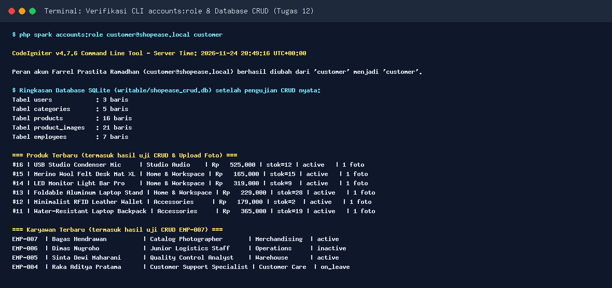

---

## 4. Skenario Pengujian Fungsional & Keamanan

| No | Skenario Pengujian | Hasil Aktual | Bukti Screenshot |
| :-: | :--- | :--- | :--- |
| 1 | Membuka beranda dwibahasa (`ID`) | Kategori & 8 produk unggulan tampil beserta gambar asli | `01-beranda-katalog.png` |
| 2 | Filter kategori `electronics` + urutan harga termurah di `/catalog` | Produk aktif terfilter rapi, produk nonaktif disembunyikan | `02-katalog-filter-pencarian.png` |
| 3 | Detail produk dengan galeri multi-foto | Foto utama, thumbnail interaktif, deskripsi & produk terkait tampil | `03-detail-produk-galeri.png` |
| 4 | Halaman masuk bersama | Satu form masuk untuk Customer, Operator, dan Admin | `04-halaman-masuk.png` |
| 5 | Login Admin → Inventaris Produk | 4 kartu ringkasan stok, filter, tabel thumbnail & paginasi tampil | `05-admin-inventaris-produk.png` |
| 6 | Melihat kartu daftar kategori | 4 kategori awal beserta jumlah produk tiap kategori tampil | `06-admin-kategori-kartu.png` |
| 7 | Menambah kategori baru (`Studio Audio` / `Audio Studio`) | Tersimpan dengan slug otomatis `studio-audio` | `07-admin-form-kategori-baru.png` |
| 8 | Menambah produk baru + unggah foto PNG multipart nyata | Produk `#16` tersimpan, foto tersimpan nama acak & tampil sebagai ★ Gambar Utama | `08-admin-edit-produk-galeri.png` |
| 9 | Uji keamanan: unggah file non-gambar (`invalid_upload.txt`) | Server menolak unggahan dengan pesan validasi MIME `text/plain` | `09-admin-upload-invalid-ditolak.png` |
| 10 | Membuka Direktori Karyawan (`/admin/employees`) | 6 karyawan awal tampil dengan pencarian & filter departemen/status | `10-admin-direktori-karyawan.png` |
| 11 | Menambah karyawan baru `EMP-007` (Bagas Hendrawan) | Tersimpan dan diarahkan ke halaman detail karyawan `/admin/employees/7` | `11-admin-karyawan-detail.png` |
| 12 | Login Operator & ganti bahasa ke English (`EN`) | Ruang kerja `/operator/products` tampil dalam Bahasa Inggris | `12-operator-inventaris-en.png` |
| 13 | Tampilan ponsel (`412px`) + Tema Gelap + filter Stok Menipis (`ID`) | Responsif di mobile, dark mode aktif, 4 produk stok 1–5 unit terfilter | `13-mobile-dark-mode.png` |

---

## 5. Tangkapan Layar Hasil Aplikasi

### 5.1 Beranda, Katalog Berfilter, Detail Multi-Foto & Halaman Masuk
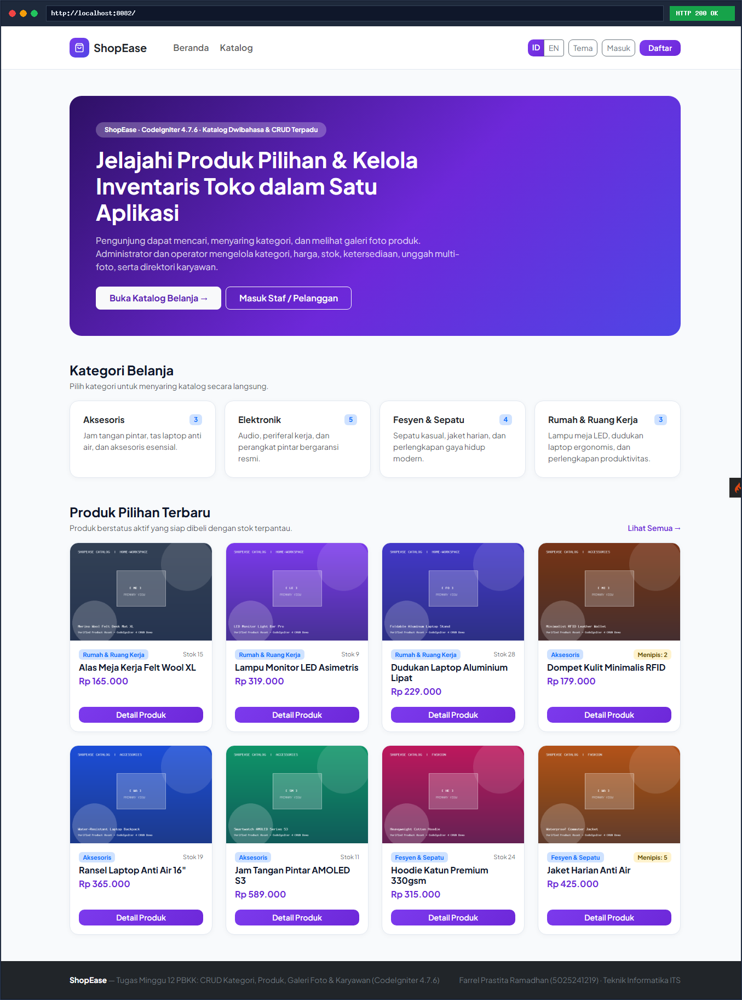
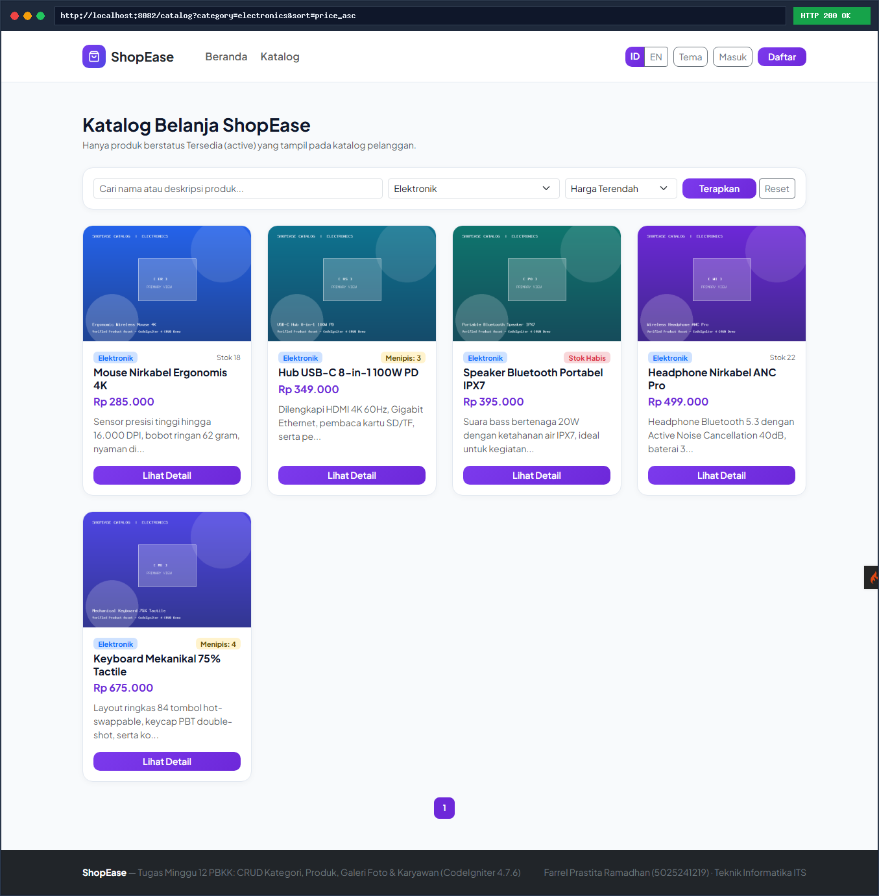
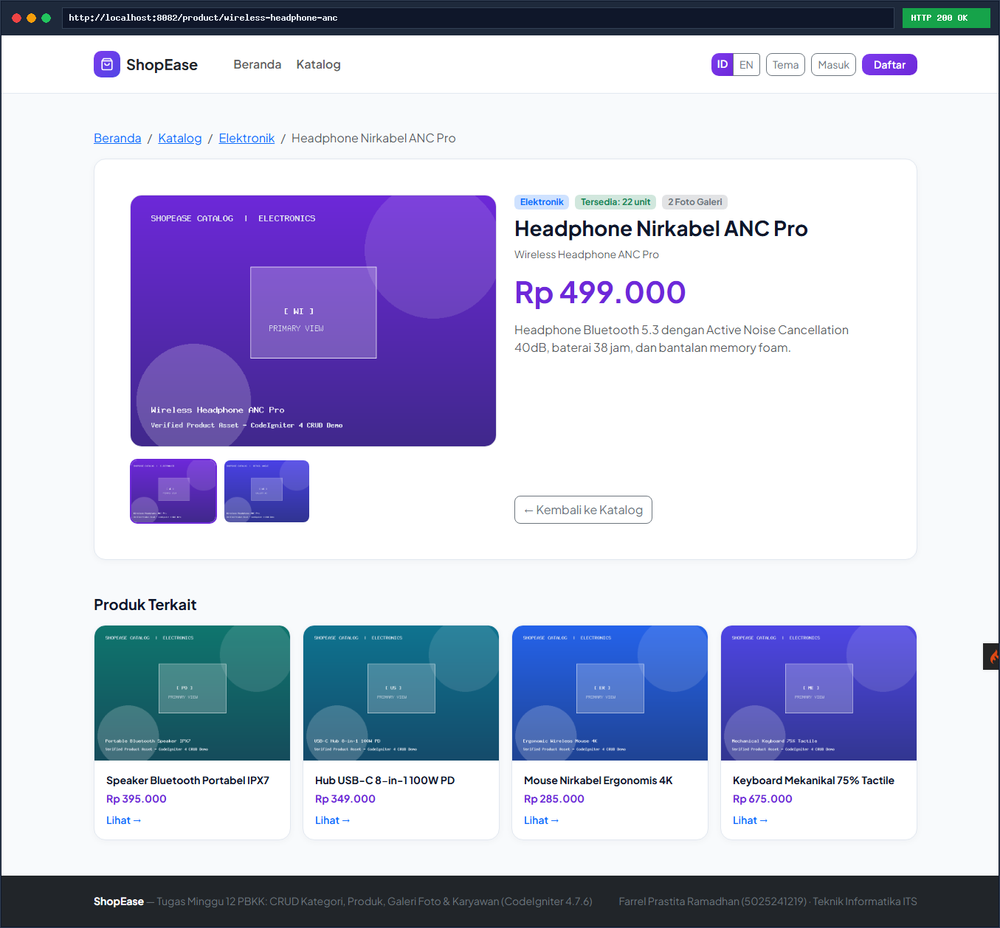
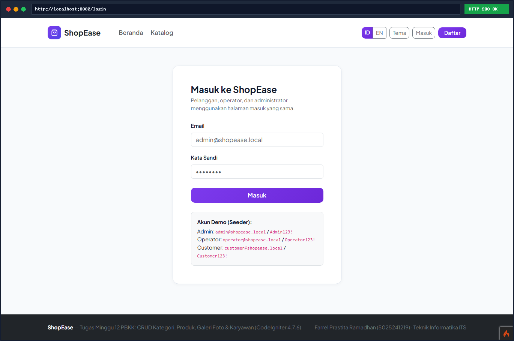

### 5.2 Ruang Kerja Administrator — Inventaris Produk & CRUD Kategori
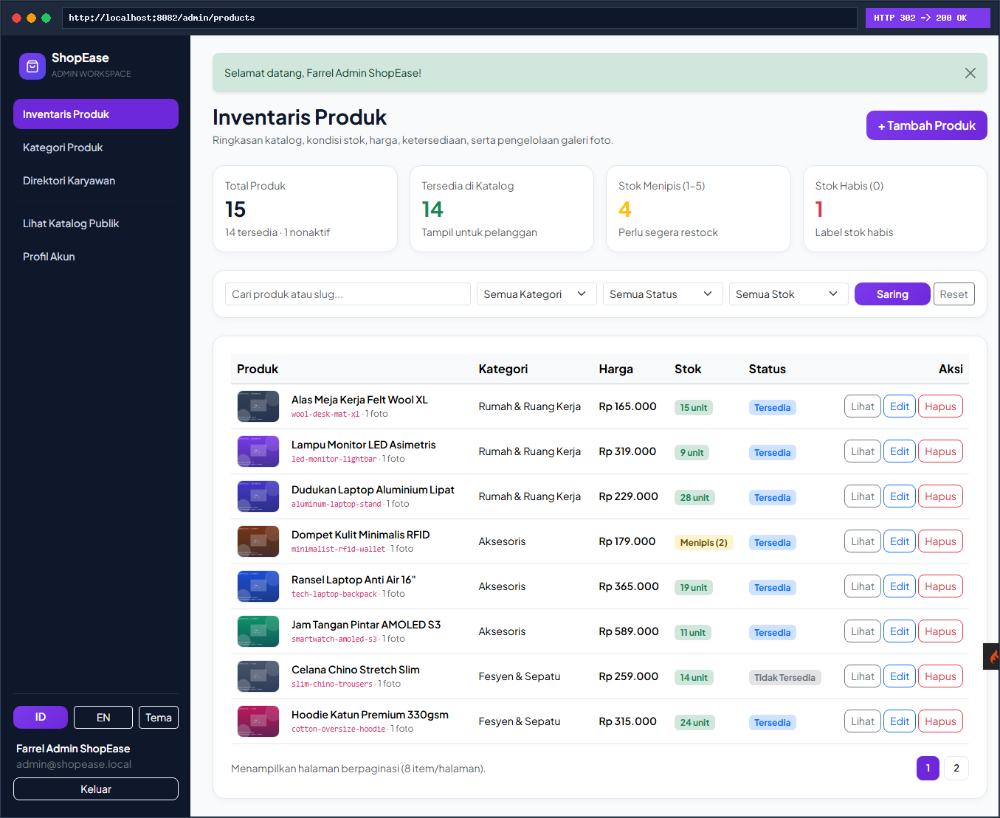
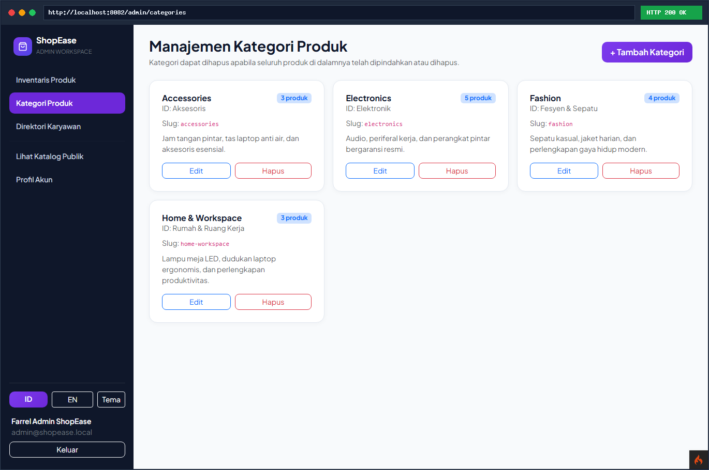
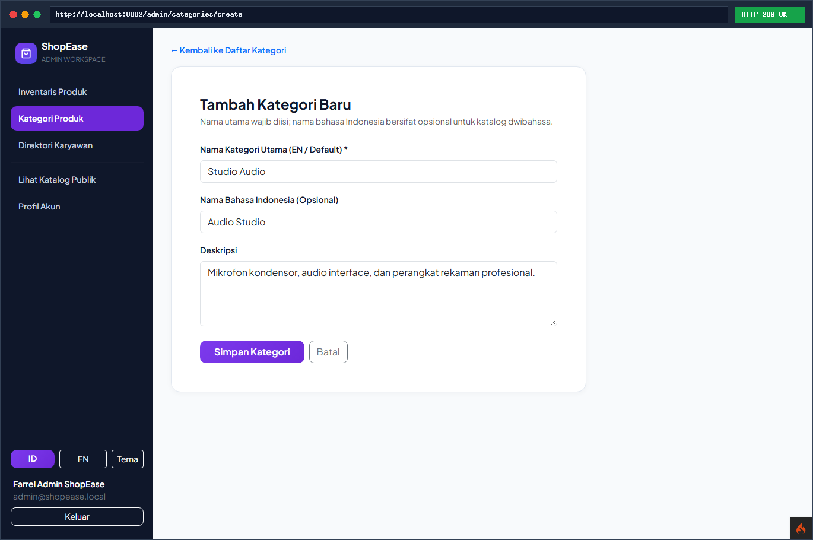

### 5.3 CRUD Produk + Unggah Foto Nyata & Pengujian Validasi File Non-Gambar
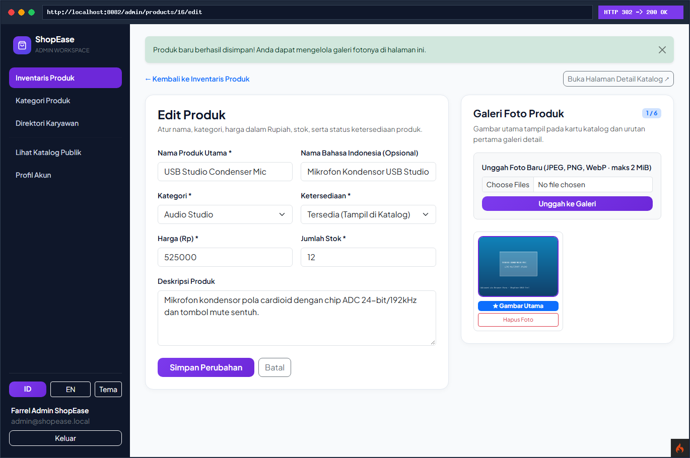
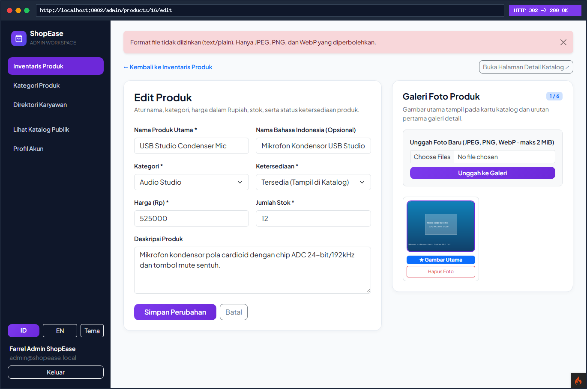

### 5.4 CRUD Direktori Karyawan (Khusus Administrator)
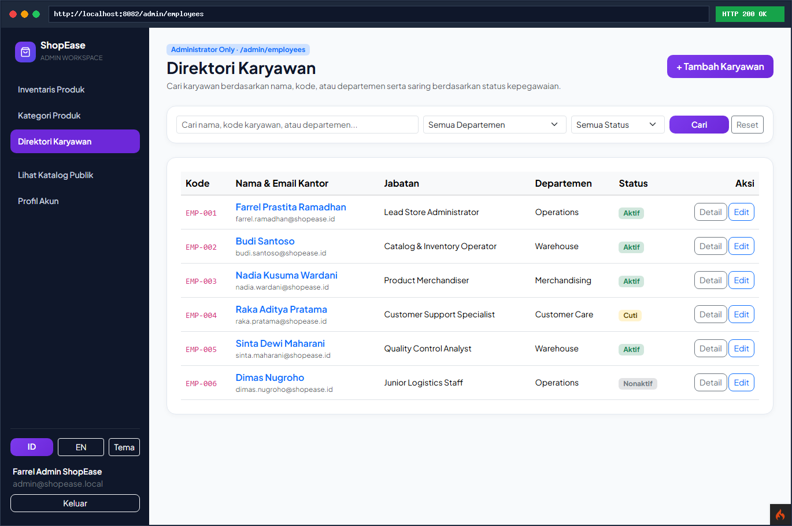
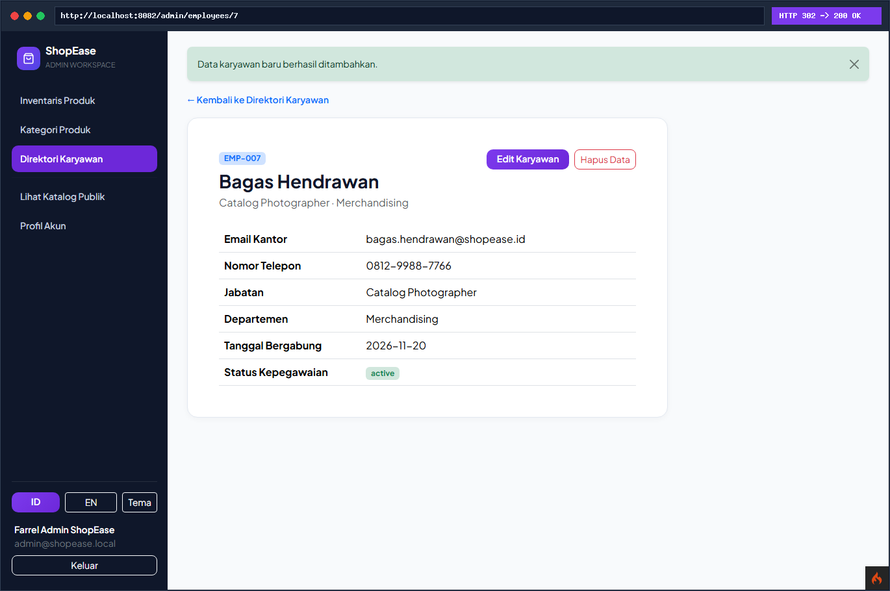

### 5.5 Ruang Kerja Operator (English) & Tampilan Mobile Tema Gelap (Filter Stok Menipis)
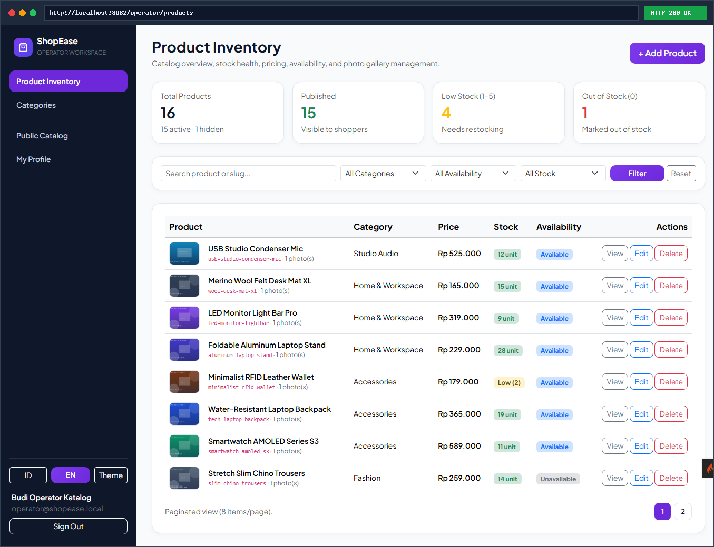
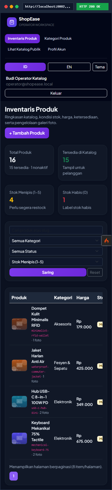

---

## 6. Instalasi & Panduan Penggunaan Lokal

### Prasyarat
- PHP 8.2+ dengan ekstensi `intl`, `mbstring`, `gd`, dan `sqlite3` (atau `mysqli` untuk MySQL 8+).

### Menjalankan dengan SQLite (Default Siap Pakai)
```powershell
cd shopease
composer install
cp .env.example .env
php spark migrate
php spark db:seed DemoCatalogSeeder
php spark serve --port 8082
```
*(Di Windows dengan XAMPP, dapat juga langsung menjalankan `.\serve.bat`.)*

### Mengatur Role Akun via CLI
```powershell
php spark accounts:role email@domain.com admin
php spark accounts:role email@domain.com operator
```

### Menggunakan MySQL (`db_shopease`)
1. Impor [`shopease/database/db_shopease_crud.sql`](shopease/database/db_shopease_crud.sql) ke MySQL.
2. Salin [`shopease/.env.example`](shopease/.env.example) menjadi `.env`, beri tanda `#` pada baris SQLite, lalu aktifkan konfigurasi `MySQLi`.
3. Jalankan `php spark migrate` dan `php spark db:seed DemoCatalogSeeder`.

### Akun Demo
| Peran | Email | Password |
| :--- | :--- | :--- |
| Administrator | `admin@shopease.local` | `Admin123!` |
| Operator | `operator@shopease.local` | `Operator123!` |
| Customer | `customer@shopease.local` | `Customer123!` |

